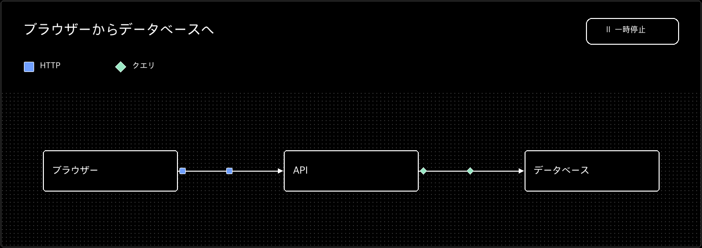

# Somen

日本語 | [English](README.md)

Somenは、HTMLでノードと接続を記述して、動きのあるフロー図を表示するWeb Componentです。特定のフレームワークに依存せず、表示領域と各ノードの大きさに合わせて配置を調整します。

現在は開発中のalpha版です。ライセンスはMITで、npmパッケージ名は`somenflow`です。



## HTMLに組み込む

図を表示するプロジェクトにパッケージをインストールします。

```sh
npm install somenflow@alpha
```

ブラウザー側のスクリプトで、カスタム要素を一度登録してください。

```js
import 'somenflow/register';
```

登録後は、HTMLで図を定義できます。

```html
<flow-diagram label="通信の流れ" autoplay>
  <flow-node name="client">クライアント</flow-node>
  <flow-connection label="リクエスト"></flow-connection>
  <flow-node name="server">サーバー</flow-node>
</flow-diagram>
```

接続を二つのノードの間に置くと、接続元と接続先を省略できます。分岐や逆方向の接続では`from`と`to`を指定します。ブラウザーでパッケージ名を使ってimportするには、バンドラーかimport mapが必要です。

関連するノードは`<flow-group name="phase" label="処理の範囲">…</flow-group>`で囲み、判断ノードには`shape="decision"`を指定します。接続ラベルは線上に表示され、不要な場合は省略できます。[グループと判断ノードのAPI](docs/api.md#groups-and-decisions)と[開発中のデモ](examples/astro-demo/src/pages/grouped.astro)を参照してください。

## 対応範囲

Somenは、記事やドキュメントに入れる小さな通信図・処理フローを対象にしています。接続関係から段を決め、同じ段の分岐は記述順に並びます。既定のレイアウトでは狭い表示領域で縦向きに切り替わり、分岐の横幅が収まらない場合は図の中をスクロールできます。CLIではJSON形式のプロジェクトを検証し、単独で表示できるHTMLページに書き出せます。

自動再生は`autoplay`を指定した場合だけ有効で、動きを減らす設定では初期再生を抑制します。閲覧者は図を一時停止・再生できます。JavaScriptが無効な場合もノードのテキストは残りますが、接続線は表示されません。

複雑なグラフの自動配置や、線の完全な交差回避には対応していません。ブラウザー操作はChromiumで確認済みで、Firefox・Safari・支援技術は未検証です。

## ドキュメント

- [CLI](packages/core/README.md#edit-and-export)
- [APIリファレンス](docs/api.md)：HTML属性、見た目、再生制御、JSON形式
- [Astroガイド](examples/astro-demo/README.md)：Markdown、MDX、構造化データ
- [開発・貢献](CONTRIBUTING.md)：開発環境、検査、リリース手順
- [セキュリティポリシー](SECURITY.md)：脆弱性の非公開報告先
